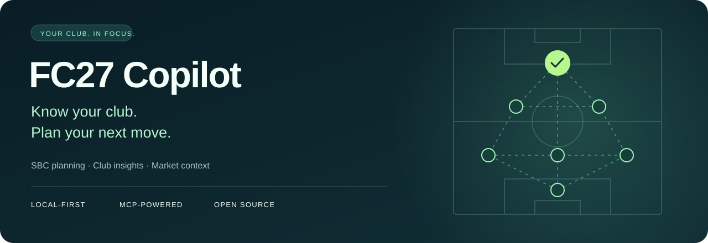

<p align="center">
  
</p>

# FC27 Copilot

**English** | [简体中文](README.zh-CN.md)

## Know your club. Plan your next move.

**Let your AI help you review players, plan SBCs, and compare market prices.** FC27 Copilot connects your Ultimate Team club to an MCP-capable AI client, grounding its suggestions in your inventory and explicit constraints.

[**Get started →**](docs/install.md) · [Try these prompts](#try-these-prompts) · [Connect OpenClaw](docs/openclaw.md) · [Report an issue](https://github.com/liusihang/fc27-copilot/issues)

**Self-hosted · Chrome / Edge · MCP stdio · MIT open source**

> Source installation, component version `0.6.0`: a local service, browser extension, and MCP client are required. No browser-store package or tagged release is published. This is an unofficial project; automated access may violate service rules or lead to account restrictions. Read [NOTICE](NOTICE.md) before use.

## Start with three useful questions

| What you want to know | How Copilot helps |
| --- | --- |
| **Can I finish this SBC with cards I already own?** | Find owned-only plans first, then compare purchase alternatives. Require specific owned players and set an overall limit. |
| **Where are my cards, and what do I have available?** | Inspect the Club, SBC Storage, Unassigned items, and Transfer List, with exact owned-copy identities. |
| **Does this card's price make sense for me?** | Compare FUT.GG references, live EA listing samples, your acquisition costs, and tax-adjusted calculations. |

You can also inspect Season rewards, objectives and Evolution progress, read formations and tactics, and perform supported account operations after approving each exact batch.

## Try these prompts

Once connected, try these prompts in your MCP client:

- **Try offline first:** “Find ST cards in the local catalog with at least 90 pace and an 85–90 overall. Show their PlayStyle+.”
- **Review your club:** “List my untradeable players in the Club and SBC Storage, grouped by overall.”
- **Plan an SBC:** “Solve this SBC using owned players only. Keep cards above 82 overall out. Show me the plan without saving or submitting it.”
- **Compare alternatives:** “Now compare plans that need one purchase versus two. List missing cards and estimated costs, without buying anything.”
- **Check progress:** “Show claimable objectives and my in-progress Evolutions.”
- **Understand a sale:** “Compare this card's reference price, live listings, and acquisition cost. Calculate net proceeds after tax at my chosen selling price.”

**Your AI interprets the goal and compares alternatives. Copilot supplies inventory, calculations, validation, and explicit operations.** The SBC planner itself never buys, saves, or submits.

## Quick start

You need **Python 3.10+, Node.js 18+, Chrome or Edge, and an MCP client with stdio support**. Live-account validation currently covers macOS and Chromium browsers. Windows commands are in the [installation guide](docs/install.md).

### 1. Start the local service

Run these commands in a macOS / Linux POSIX shell. The extension has no npm dependencies; `npm install` is not required.

```bash
git clone https://github.com/liusihang/fc27-copilot.git
cd fc27-copilot
python3 -m venv .venv
.venv/bin/python -m pip install -r requirements.txt
.venv/bin/python scripts/validate_catalog.py data/catalog.sqlite
npm run check
npm run build:extension
.venv/bin/python fc27d.py
```

Keep the service running at `http://127.0.0.1:3926`; open `/health` to check readiness. The player catalog is bundled: **offline card queries need no EA login or initial catalog download**.

### 2. Load the browser extension

Open `chrome://extensions` or `edge://extensions` → enable Developer mode → Load unpacked → select the project's **`dist`** directory.

Open the [official Ultimate Team Web App](https://www.ea.com/ea-sports-fc/ultimate-team/web-app/) and sign in yourself. The extension connects and synchronizes automatically. No copied EA token or extension ID is needed.

### 3. Connect your AI client

For clients using the `mcpServers` format, replace both absolute paths in this configuration:

```json
{
  "mcpServers": {
    "FC27": {
      "command": "/absolute/path/fc27-copilot/.venv/bin/python",
      "args": ["/absolute/path/fc27-copilot/mcp_stdio.py"]
    }
  }
}
```

Start with `status` and `catalog_query`, then check `club_query` after login. **The stdio adapter does not start the daemon.** Set the client tool timeout to at least **240 seconds** when supported, and retain approval prompts for `execute_actions`.

[Full installation and troubleshooting](docs/install.md) · [OpenClaw CLI and macOS background service](docs/openclaw.md)

## Review each batch before it runs

Queries and planning can come first. Purchases, listings, squad changes, and SBC submission require your approval for each exact batch, with targets, limits, and irreversible effects shown first. **Approve SBC save and submission separately; submission consumes players.**

Defaults allow one action per batch and cap individual purchases, batch spend, and daily spend at 700 coins each. Set `policy.json` to `observe` to disable account writes while you explore. Keep your client's approval prompts enabled.

[Read the full execution policy](docs/execution-policy.md)

## Good to know before you start

- **The catalog is a snapshot.** The bundled FUT.GG catalog was completed on **2026-09-18** and contains **19,676 cards / 19,595 players**. Login syncs account inventory, not card definitions. Follow the [data guide](data/README.md) to refresh the catalog for newer cards.
- **SBC coverage has limits.** Automatic candidates exclude protected, loan, special, Evolution, and current active-squad items. Unsupported requirements block solving. Optimality applies only to the reported candidate domain or local neighborhood.
- **Prices are context.** They do not guarantee availability, sale proceeds, or profit. Larger purchase searches may time out; compare levels incrementally.
- **Run it on your own computer.** This is a local, single-user system. Do not expose its ports to the internet. Account databases and operation history are stored locally; raw EA session credentials remain in Web App page memory. Your AI client may still send tool results to its model provider; review its data handling.
- **Rebuild the extension when updating.** Back up local policy and catalog changes, stop the service, and follow the [upgrade steps](docs/install.md#updating). Reloading an old `dist` does not update extension files.

<details>
<summary>Advanced: execution policy, MCP tools, and developer checks</summary>

## Execution policy details

Queries and planning can come first. Account writes such as purchases, listings, squad changes, and SBC submission require explicit approval after presenting the exact targets, players, limits, and irreversible effects.

- **Approve SBC save and submission separately.** Submission consumes players. Asking to complete an SBC does not authorize submission.
- **Set limits locally.** The default `suggest` policy allows one action per batch and caps individual purchases, batch spend, and daily spend at 700 coins each.
- **Use observation-only mode.** Set `policy.json` to `observe` to disable all account writes.
- **Keep client approval prompts enabled.** The backend requires `confirmed=true`, but this declaration cannot independently prove human consent. Use a client that visibly requests approval.
- **Verify unknown outcomes.** Do not automatically retry a write that may already have happened. Changed targets or limits require renewed approval.

[Read the full execution policy](docs/execution-policy.md)


## MCP tools

The server is named `FC27` and exposes 12 tools. Client-specific name prefixes may differ.

| Tool | Purpose |
| --- | --- |
| `status` | Inspect service, session, synchronization, policy, and backoff readiness. |
| `catalog_query` | Search and compare local player-card definitions. |
| `club_query` | Read the latest complete local owned-item mirror. |
| `squad_query` | Read live squad slots, formations, tactics, and supported options. |
| `sync_club` | Refresh coins and inventory into the local account database. |
| `market_search` | Obtain live EA listings and concrete trade IDs. |
| `price_context` | Refresh reference prices and compare history, holdings, costs, and net proceeds. |
| `content_query` | Read Season, objective, and Evolution content and progress. |
| `sbc_query` | Read cached SBC sets, challenges, requirements, and status. |
| `sbc_refresh` | Refresh current SBC state from the authenticated Web App. |
| `sbc_solve` | Generate validated owned-only and purchase-budget plans. |
| `execute_actions` | Perform an exact, user-approved batch of account operations. |

Full parameter, result, and error definitions are documented in the [MCP contract](docs/mcp-contract.md).

## Development

```bash
npm run check
.venv/bin/python -m unittest discover -s tests
```

`check` validates Python syntax and the browser extension. Automated tests use local fixtures and do not perform live EA account operations; source-database tests may skip when their input is unavailable. Live installation acceptance requires the user to sign in to the Web App.

CI runs offline tests, catalog validation, and extension checks/build on a clean checkout. It does not validate live EA behavior or prove that prior Git history is free of private information. See [CONTRIBUTING](CONTRIBUTING.md) for the manual read-only checklist and publication boundaries.

</details>

## Documentation

- [Installation](docs/install.md)
- [OpenClaw integration and macOS service](docs/openclaw.md)
- [MCP contract](docs/mcp-contract.md)
- [Execution policy](docs/execution-policy.md)
- [SBC planning and execution](docs/sbc-contract.md)
- [Architecture](docs/architecture.md)
- [Database schema](docs/database-schema.md)
- [Contributing and testing](CONTRIBUTING.md)
- [Changelog](CHANGELOG.md)

## License and third-party services

Original project code and documentation are licensed under the [MIT License](LICENSE). Third-party source, data, artwork, trademarks, and service access remain subject to their respective licenses and terms.

This project is unofficial and is not affiliated with or endorsed by Electronic Arts or FUT.GG. Automated access may violate applicable service rules or result in account restrictions. The project does not bypass CAPTCHA, verification, rate limits, transfer restrictions, or access controls. Review [NOTICE](NOTICE.md) and the applicable service terms before use.

